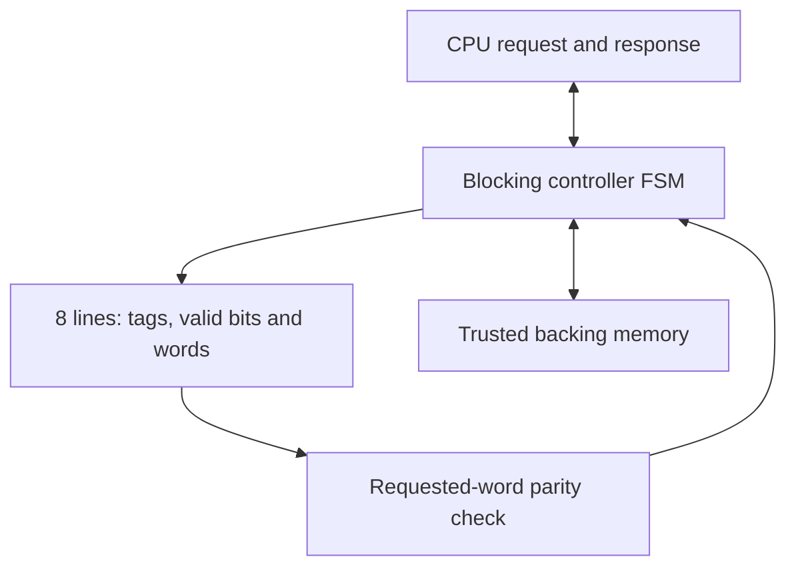

# CacheGuard

**A fault-aware, read-only direct-mapped cache with parity detection, automatic refill recovery, and self-checking SystemVerilog verification.**

CacheGuard implements a 128-byte cache: eight lines, four 32-bit words per line, and a 32-bit byte-address interface. It checks the requested word's parity before producing a successful CPU response. On a detected mismatch it invalidates the line, fetches four fresh words from trusted backing memory, rechecks the requested word, and completes the original request.

The engineering focus is recovery correctness under stalls, refill-time faults and reset, with reproducible measurements and an explicit fault model. Direct mapping, parity and refill recovery are established techniques; this repository does not claim a novel cache architecture.

## Verified release v1.1

Reference runs were executed on Linux using Icarus Verilog 12.0, Verilator 5.020 for RTL lint, and Yosys 0.33 for generic synthesis. Windows execution and hosted CI execution have not been performed.

| Check | Executed result |
|---|---|
| Functional regression | 6 passing runs: baseline/protected, seeds 1, 17, 2026 |
| Scoreboard | 21,996 completed reads checked; 48 intentional reset aborts |
| Protected data faults | 3,078 detected and recovered across three runs |
| Fault positions | All 1,024 cache-data bit positions exercised per protected run |
| Other protection tests | Parity-bit recovery, baseline corruption, even-bit parity limitation |
| RTL lint | Both variants pass `--lint-only -Wall` |
| Generic synthesis | Baseline 2,863 cells; protected 3,032 cells; 5.90% overhead |
| Workload/delay sweep | 24 passing simulations; 6,144 additional checked reads |

These counts describe this finite regression. They are not formal correctness, radiation qualification, timing closure or physical implementation claims. See [the measured report](reports/reference/RESULTS.md) and its accompanying raw logs/JSON.

The [workload sweep](reports/reference/WORKLOADS.md) measures repeated-word, sequential, conflicting and uniform-random addresses at three memory delays. Hit rates range from 0% for deliberate conflicts to 99.61% for repeated-word reuse. The report explains those tradeoffs instead of presenting one hit rate as universal.

## Start here on Windows

Extract the ZIP, open PowerShell inside the `CacheGuard` folder, and run:

```powershell
iverilog -V
vvp -V
py -3 scripts/run.py sim --seeds 1 --random 1000 --vcd
gtkwave build/cacheguard.vcd
```

`-V` is uppercase. The Python runner needs only the standard library. A successful run prints `PASS` lines and writes `reports/latest/RESULTS.md`. If `py` is unavailable but Python is installed, use `python` in its place. Detailed setup and a no-Python simulation command are in [WINDOWS.md](docs/WINDOWS.md).

Full reproduction with all tools on PATH:

```text
python scripts/run.py all --seeds 1 17 2026 --random 1000
python scripts/mutation_check.py
python scripts/benchmark.py
```

Simulation, lint and synthesis can also be run separately with `sim`, `lint` or `synth`. The optional mutation check deliberately breaks four temporary RTL copies and verifies that the regression rejects them; it does not edit the real RTL.

## Design at a glance



| Property | Choice |
|---|---|
| Address | 32-bit byte address, full tag retained |
| CPU operation | Aligned 32-bit read; one outstanding transaction |
| Tag / index / word / byte | `[31:7]` / `[6:4]` / `[3:2]` / `[1:0]` |
| Allocation | Full-line refill, words 0 to 3; no early restart |
| Protection | One even-parity bit per 32-bit word |
| Recovery | Invalidate, refill, verify, respond |
| Flow control | Independent ready/valid request and response channels |
| Reset | Synchronous active-high; cache and memory peer reset together |
| Alignment error | Response with `cpu_rsp_error=1`, data zero; no memory access |
| Baseline | `ENABLE_PARITY=0`; otherwise identical interfaces and FSM |

The RTL has no fault-injection ports. The verification environment changes storage hierarchically between clock edges. Only `rtl/` is synthesized.

## What is protected

A single transient bit flip in cached data, before that word's validation, is detected and recovered under the documented assumptions. A parity-bit-only flip also triggers recovery. A detected bad word is not returned as a successful response.

Parity does **not** detect every multi-bit error. Two data-bit flips in one word can preserve parity; an executable test demonstrates the resulting undetected corruption. Tags, valid bits, control registers, interconnect and the CPU response register are outside this protection boundary. Backing memory must return correct, stable data and eventually respond. There is no timeout or uncorrectable-error escalation.

Read-only operation assumes the cached memory region is immutable during use. There are no writes, coherency, invalidation commands, byte/halfword loads, bus IDs, ECC, CPU integration, FPGA validation or technology-specific area/timing results in this release.

## Repository guide

| Path | Purpose |
|---|---|
| `rtl/cacheguard.v` | Request latch, controller, refill sequencing, held response, events |
| `rtl/cacheguard_array.v` | Data, tag, valid and parity storage |
| `tb/backing_memory.sv` | Configurable-latency deterministic ROM and request stalls |
| `tb/tb_cacheguard.sv` | Scoreboard, assertions, directed/random tests, fault campaign, metrics |
| `tb/tb_protection_limits.sv` | Baseline failure and parity limitations/recovery demonstrations |
| `tb/tb_workloads.sv` | Golden-data and per-read timing checks across workload patterns |
| `scripts/run.py` | Simulation, lint, synthesis and report generation |
| `scripts/mutation_check.py` | Checks that representative broken RTL is rejected |
| `scripts/benchmark.py` | Four patterns × three delays × two variants, with an independent Python model |
| `synth/generic.ys.in` | Shared baseline/protected synthesis flow |
| `reports/reference/` | Executed reference logs, source hashes, statistics and report |
| `.github/workflows/verify.yml` | Regression, lint, synthesis, mutation checks and workload sweep; hosted execution pending |

## Learn the implementation

1. Read [FIRST_STEPS.md](docs/FIRST_STEPS.md) for the first local run and a small address example.
2. Read [ARCHITECTURE.md](docs/ARCHITECTURE.md) for ports, FSM, timing and assumptions.
3. Read [VERIFICATION.md](docs/VERIFICATION.md) for the scoreboard, assertions and test matrix.
4. Use [WAVEFORMS.md](docs/WAVEFORMS.md) to inspect actual miss, hit, recovery and reset signals.
5. Review [INTERVIEW.md](docs/INTERVIEW.md) and [RESUME.md](docs/RESUME.md) after reproducing and understanding the results.

## Possible later work

The fixed geometry is intentional. Future work can add parameterized line count, explicit memory errors/timeouts, metadata protection, SECDED, or a processor adapter. Write support needs a separate consistency policy. None of those features is required to reproduce the current verified scope.

## Tool references

- [Icarus command-line flags](https://steveicarus.github.io/iverilog/usage/command_line_flags.html)
- [Verilator command-line reference](https://verilator.org/guide/latest/exe_verilator.html)
- [Yosys statistics command](https://yosyshq.readthedocs.io/projects/yosys/en/v0.54/cmd/stat.html)
- [Yosys synthesis flow](https://yosyshq.readthedocs.io/projects/yosys/en/latest/using_yosys/synthesis/synth.html)

The source code and measured logs, rather than version-sensitive documentation examples, define this release's reproduced behavior.
