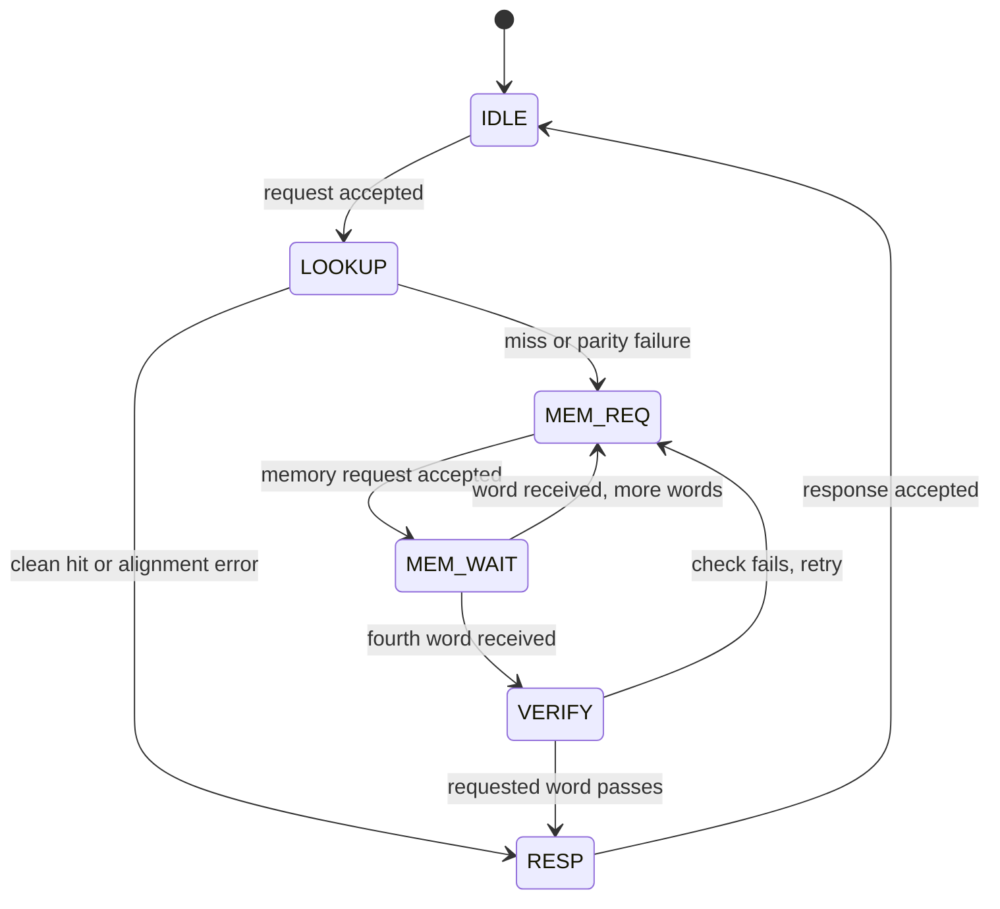

# Architecture and interface contract

## Address and storage

There are 8 lines × 16 bytes = **128 data bytes**. Each line stores four 32-bit words, one 25-bit tag and one valid bit. The protected build stores four parity bits per line.

| Address field | Bits | Width | Meaning |
|---|---|---:|---|
| Tag | 31:7 | 25 | Identifies which memory block occupies the index |
| Index | 6:4 | 3 | Selects one of eight lines |
| Word offset | 3:2 | 2 | Selects one of four words |
| Byte offset | 1:0 | 2 | Must be zero for this interface |

The array contains 1,024 data bits, 200 tag bits and 8 valid bits, plus 32 parity bits when enabled. Control and response registers are additional. Storage is inferred with asynchronous reads and synchronous writes; generic synthesis maps it to logic and flip-flops. No SRAM/BRAM macro is promised.

For `0x0000012C`: tag = 2, index = 2, word = 3, byte = 0. Its line base is `0x00000120`. Address `0x000001AC` has tag = 3, the same index = 2 and word = 3, so the two lines conflict. Addresses separated by `0x80` bytes have the same index.

## CPU port

All transfers occur at a rising edge where `valid && ready` is true. Signal names are from `cacheguard.v`.

| Signal | Direction relative to cache | Contract |
|---|---|---|
| `clk` | Input | Single clock domain |
| `rst` | Input | Active-high synchronous reset; assert across a rising edge |
| `cpu_req_valid` | Input | Producer has a request |
| `cpu_req_ready` | Output | High only in IDLE and outside reset |
| `cpu_req_addr[31:0]` | Input | Stable while request valid is held against not-ready |
| `cpu_rsp_valid` | Output | Response available; held until accepted |
| `cpu_rsp_ready` | Input | Consumer accepts the response |
| `cpu_rsp_data[31:0]` | Output | Valid only with response valid; held under backpressure |
| `cpu_rsp_error` | Output | One for unaligned requests, zero for completed aligned reads |

The request address is latched exactly once. The producer may change it only after acceptance or cancel it on reset. No new request is accepted until the previous response has been consumed. A producer may keep request-valid high continuously, presenting the next address after each acceptance.

A misaligned address produces a response with error set and data zero. It is not rounded down, allocated, or sent to memory. Parity recovery normally completes successfully without setting `cpu_rsp_error`: this bit is an alignment error indicator, not a notification that an internal retry happened.

## Memory port

| Signal | Direction | Contract |
|---|---|---|
| `mem_req_valid` | Output | Word read request available |
| `mem_req_ready` | Input | Memory accepts request |
| `mem_req_addr[31:0]` | Output | Aligned word address, stable until acceptance |
| `mem_rsp_valid` | Input | Correct response for the sole outstanding memory request |
| `mem_rsp_ready` | Output | Cache accepts response in MEM_WAIT |
| `mem_rsp_data[31:0]` | Input | Stable while response is valid and not accepted |

There is at most one memory read outstanding. Memory must preserve order, return exactly one response per accepted request, and eventually respond. There are no burst signals, IDs, timeouts or memory-error ports. A memory implementation may offer a response immediately but must hold it until `mem_rsp_ready`; the cache does not consume it on the request-acceptance edge.

The memory region must not change behind the cache. A CPU/agent write to backing memory would make cached words stale. This is suitable for an immutable test ROM or an instruction-memory experiment, not a coherent writable system.

## FSM

Each state waits if its required handshake is absent. Reset from every state returns to IDLE and clears all valid bits. The diagram omits those reset edges for readability.

| State | Encoding | Main action |
|---|---:|---|
| IDLE | 0 | Accept and latch one CPU address |
| LOOKUP | 1 | Check alignment, tag and selected-word parity; invalidate on miss/error |
| MEM_REQ | 2 | Hold line-base + 4×beat until memory accepts |
| MEM_WAIT | 3 | Wait for and store one word with fresh parity |
| VERIFY | 4 | Recheck requested word after the entire line is committed |
| RESP | 5 | Hold registered CPU data/error until accepted |

Refill always starts at word 0 and ends at word 3. The victim line is invalid before the first memory request. Each accepted memory response writes one data word and its parity. The fourth response commits the tag and sets the valid bit at the same edge as its word write. VERIFY follows on the next cycle, so it sees completed storage.

VERIFY is deliberate: if a previously written requested word is corrupted while later words are still arriving, it is checked again before delivery. A new detected error invalidates and refills again. There is no early restart or critical-word-first optimization.

## Parity and recovery boundary

On write, `p = ^data` stores the XOR of all 32 data bits. On read, `bad = (^data) ^ p`. A one-bit flip changes this comparison; two flipped bits in the same word may cancel. Parity identifies a mismatch but cannot locate the flipped bit, so correction comes from the trusted memory copy.

Only the selected word is checked. A fault in another word remains latent until that word is requested, unless the line is replaced first. If a line's tag does not match, its data is not used and it is refilled without classifying any stale data parity.

The safety statement is conditional: **a detected parity mismatch never produces a successful response containing that corrupted word**. It does not assert detection of every possible corruption. Assumptions:

- Fault injection changes cached data (or, in one separate test, a stored parity bit) between clock edges.
- Tag, valid, address, FSM, handshake logic and response-register faults are outside the model.
- A data fault after a clean word has been copied into the response register does not change that already-captured response. The response register itself has no protection.
- Backing memory and transfer data are correct. Corruption received from memory can acquire matching freshly computed parity and is not detected here.
- A transient fault is overwritten by a correct refill. A persistent/repeated fault may cause endless retries; no retry limit is implemented.
- Clock-domain crossings and metastability are outside this single-clock model.

## Reset and cancellation

Reset is synchronous for storage/control, with combinational gating that suppresses interface ready/valid while `rst` is high. The cache invalidates every line and abandons its in-flight CPU request. Data/tag/parity arrays need not be cleared because invalid lines cannot satisfy a hit.

**The memory peer must reset or flush outstanding responses at the same time.** Without transaction IDs, resetting only the cache can leave a stale response that could be confused with a later refill. This implementation deliberately requires a shared reset contract. The test memory implements it, and the scoreboard separately counts aborted CPU requests.

The CPU must treat a reset-aborted request as cancelled and issue a new request after reset if it still needs the data. It must not expect the old response.

## Events and measurement

`evt_hit`, `evt_miss`, `evt_parity_error`, and `evt_refill_done` are one-cycle registered pulses. They are exposed for counters/observation; the top level contains no performance counters.

- Hit and miss classify only the initial aligned lookup. A matching corrupted line is a **tag hit**, followed by a parity event and recovery.
- VERIFY and retry do not create additional demand hit/miss events.
- Each detected selected-word mismatch pulses the parity event.
- Each completed four-word refill pulses refill-done, including retries.
- Alignment errors do not create hit/miss events.
- Reset clears pulses; an aborted request can have produced events before cancellation.

Benchmark rates use an isolated, fault-free, no-reset interval, so hits + misses = completed reads there. Fault-campaign counts must not be mixed with benchmark rates.

## Cycle timing

The testbench measures first-response latency as `first edge sampling cpu_rsp_valid − request-acceptance edge`. Clean hits take **2 cycles** with this definition. Earliest continuous hit request acceptance spacing is **3 cycles**, because a new request is accepted in IDLE after consuming the prior response.

In the supplied memory model, `latency_cycles=L` means `rsp_valid` is asserted after the Lth rising edge following request acceptance. The earliest response transfer is the following edge, L+1 cycles after request acceptance. Jitter adds 0 through `jitter_cycles` to L. With no stalls or jitter, a full miss takes `4×(L+2)+3` cycles from CPU request acceptance to first valid response sampling. At L=1 this is **15 cycles**, explicitly checked by the testbench.

CPU response backpressure can lengthen completion latency without changing first-response latency. Memory request stalls and response scheduling delays lengthen a miss or recovery. The benchmark uses exactly the same FSM, memory model and address trace for both variants. Parity is combinational in the lookup path and adds no RTL cycles; maximum clock frequency may nevertheless differ and has not been measured.
